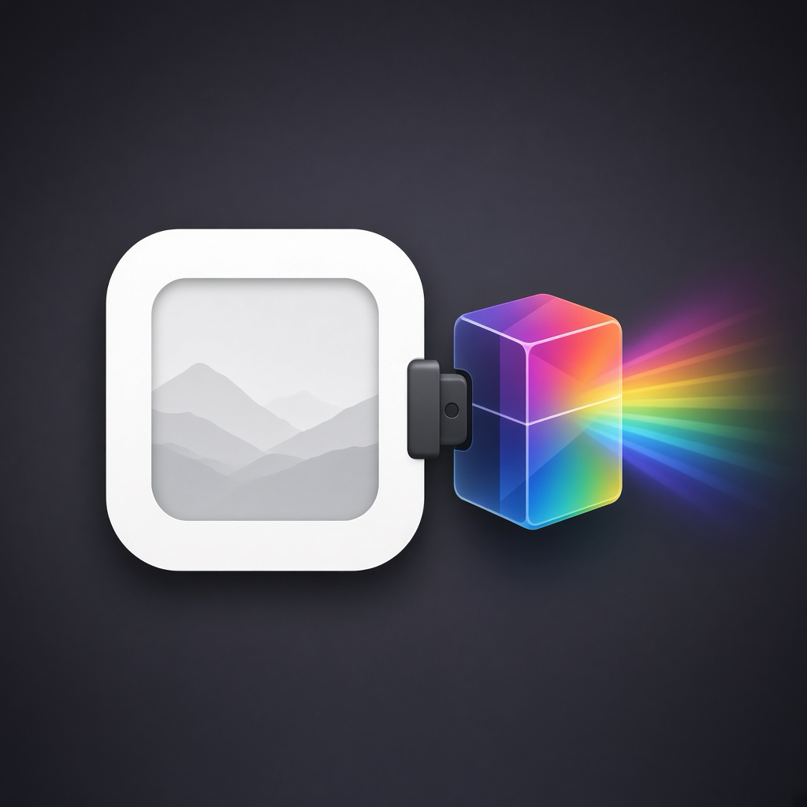

<p align="center">
  
</p>

# OfxHost

[](https://github.com/aaronmurniadi/ofxhost/releases/latest)


[](https://discord.gg/B69ZgZRzk)

<a href="https://www.buymeacoffee.com/aaronmurniadi"></a>

A minimal still-image [OpenFX](https://github.com/AcademySoftwareFoundation/openfx) **plugin host**.
Open a RAW (or PNG/JPEG/TIFF/EXR) photo, run it through one or more OFX filter plugins, preview the result,
and export to PNG, JPEG, or 16-bit TIFF — no video NLE required.

Use it to try OFX effects that normally only run inside Resolve, Nuke, or similar hosts,
on still photos and a simple processing chain.

---

## Tested OFX plugins

| Plugin              | What it does                                                                                                                                                                                                    | Link                                                                                                                         |
| ------------------- | --------------------------------------------------------------------------------------------------------------------------------------------------------------------------------------------------------------- | ---------------------------------------------------------------------------------------------------------------------------- |
| **spektrafilm-ofx** | Film simulation (film, print, scan, grain, halation, diffusion)                                                                                                                                                 | [chaert-s/spektrafilm-ofx](https://github.com/chaert-s/spektrafilm-ofx) / [spektrafilm.114c.de](https://spektrafilm.114c.de) |
| **ntsc-rs**         | Analog video / VHS-style effects                                                                                                                                                                                | [valadaptive/ntsc-rs](https://github.com/valadaptive/ntsc-rs)                                                                |
| **purzOS**          | A collection of 64 native OpenFX video plugins for DaVinci Resolve, Natron, and any other OFX host — retro/analog looks, pixelart, glitch, datamosh, CRT/VHS signal artifacts, colour grades and optical warps. | [purzbeats/purzos-ofx](https://github.com/purzbeats/purzos-ofx)                                                              |

Other OFX filter plugins should work 🤞 If you confirm one, a PR to this table is welcome.

---

## Install

Download the package for your system from [Releases](https://github.com/aaronmurniadi/ofxhost/releases/latest).

### macOS

- **Apple Silicon (M1 and later):** `OfxHost-macOS-arm64.dmg`
- **Intel:** `OfxHost-macOS-x86_64.dmg`

Open it and drag **OfxHost** onto **Applications**.
The app is ad-hoc signed, so on first launch right-click it and choose **Open**, or run:

```sh
xattr -dr com.apple.quarantine /Applications/OfxHost.app
```

### Windows

Download `OfxHost-Windows-x64.exe` and run it. It is one self-contained file: the
libraries, the icon font, and the bundled plugins are all inside it, so there is nothing
to unpack and nothing to install, and it opens no console window. Windows may warn about
an unknown publisher because the executable is not code-signed.

The host needs an OpenGL 3.3 driver. On a machine without one, such as a virtual machine
or a remote desktop session with the generic display driver, it falls back to legacy
OpenGL rendering so the window still opens. When the window cannot start at all, a message
box explains why.

Run `OfxHost-Windows-x64.exe --selftest` from a command prompt to check the installation,
or to see the plugin load warnings. The console output appears in the terminal that starts it.

### Linux

Download `OfxHost-Linux-x86_64.AppImage`, then make it executable and run it:

```sh
chmod +x OfxHost-Linux-x86_64.AppImage
./OfxHost-Linux-x86_64.AppImage
```

The AppImage carries the host, the bundled plugins, and the libraries it needs.
It prefers OpenGL 3.3 and falls back to legacy OpenGL rendering when the driver offers
neither. The file dialogs use `zenity` or `kdialog`, so install one of them if the Open and
Export dialogs do not appear:

```sh
sudo apt install zenity
```

The AppImage carries update information, so AppImageUpdate updates it in place. A stable
build follows the newest stable release. A build from a `release/vX.X.X` branch follows the
newest pre-release, which is what the in-app update check does for a development build.

The release publishes the `.zsync` file that the update tool reads. Get `appimageupdatetool`
from the AppImageUpdate releases, and pass `-O` so it replaces the file in place:

```sh
appimageupdatetool -O ./OfxHost-Linux-x86_64.AppImage
```

An AppImage released before v0.4.3 carries no update information, so download one v0.4.3 or
later build by hand once to start receiving in-place updates.

Nothing is signature-verified, so an in-place update trusts the GitHub release channel.

---

## Installing OFX plugins

OfxHost loads plugins from the platform default OFX directory plus any paths in `OFX_PLUGIN_PATH`:

| Platform | Default path                                |
| -------- | ------------------------------------------- |
| macOS    | `/Library/OFX/Plugins`                      |
| Linux    | `/usr/OFX/Plugins`                          |
| Windows  | `C:\Program Files\Common Files\OFX\Plugins` |

Install plugins the way their authors recommend (installer, package, or copy `*.ofx.bundle`
into the directory above). For example on macOS:

```sh
sudo mkdir -p /Library/OFX/Plugins
sudo cp -R path/to/*.ofx.bundle /Library/OFX/Plugins/
```

Or point the host at a build directory without copying (apps launched from Finder
don't see shell variables, so start it from the terminal):

```sh
OFX_PLUGIN_PATH=/path/to/plugins /Applications/OfxHost.app/Contents/MacOS/OfxHost
```

Restart OfxHost after installing plugins. If none are found, the status bar says so.

---

## Build

Requires CMake 3.16+, a C++17 compiler, [LibRaw](https://www.libraw.org/),
[libtiff](https://libtiff.gitlab.io/libtiff/), [Little CMS 2](https://www.littlecms.com/),
[libwebp](https://developers.google.com/speed/webp), and [JPEG XL](https://libjxl.readthedocs.io/).
GLFW and Dear ImGui are fetched automatically by CMake.

```sh
# macOS
brew install cmake libraw libtiff little-cms2 webp jpeg-xl

# Debian/Ubuntu
sudo apt install cmake pkg-config libraw-dev libtiff-dev liblcms2-dev libwebp-dev \
  libjxl-dev zlib1g-dev libgl1-mesa-dev xorg-dev

# Windows: install the dependencies with vcpkg (see vcpkg.json). The static
# triplet links them into the executable, which is how the release is shipped.
vcpkg install --triplet x64-windows-static

git clone --recursive https://github.com/aaronmurniadi/ofxhost.git
cd ofxhost
./build.sh
```

On Windows, configure CMake with the vcpkg toolchain. `OFX_VERSION_LABEL` is stamped into
the file properties of the executable:

```cmd
cmake -S . -B build -G "Visual Studio 17 2022" -A x64 ^
  -DCMAKE_TOOLCHAIN_FILE=C:/vcpkg/scripts/buildsystems/vcpkg.cmake ^
  -DVCPKG_OVERLAY_TRIPLETS=packaging/vcpkg-triplets ^
  -DVCPKG_TARGET_TRIPLET=x64-windows-static ^
  -DOFX_VERSION_LABEL=0.4.3
cmake --build build --config Release
```

On macOS this produces `build/OfxHost.app`. On Linux, `build/OfxHost` plus the
`build/Plugins/OfxHost.ofx.bundle` folder next to it. On Windows, the single
`build/Release/OfxHost.exe` holds the bundled plugins and the icon font.

```sh
# Enable native CPU instructions (AVX, F16C, etc.) for extra speed
OFX_NATIVE_ARCH=1 ./build.sh

# Build and run the self-test in one step (macOS, Linux, and the Windows exe)
TEST=1 ./build.sh

# The self-test is its own binary: it links the libraries, so it needs no window
build/OfxHostTests

# --selftest on the app forwards to it, and the macOS bundle and the AppImage
# ship it, so the shipped artefact can check itself
build/OfxHost.app/Contents/MacOS/OfxHost --selftest
```

### Debug the release workflow locally

[`act`](https://github.com/nektos/act) runs `.github/workflows/release.yml` in a
Docker container, so a change to the CI is tested without pushing a tag.
`mise install` puts `act` and its pinned version in place, and `act.sh` wraps the
part of the workflow that a local run can do:

```sh
mise install

# The jobs and the events, as act reads them
./act.sh list

# The prepare job: the version, the tag, and the pre-release flag
./act.sh prepare

# The dev path, which publishes the tag vX.X.X-dev-<short sha>
./act.sh prepare dev

# The whole linux job: apt dependencies, libjxl, build, self-test, AppImage
./act.sh linux

# The plan only, with no container
./act.sh dryrun
```

`.actrc` maps both runner labels to the 22.04 image, because the linux job keeps
the glibc baseline of `ubuntu-22.04`. `act.sh` writes the event payload to
`.act/event.json` from the real `git` state, so a local run reads the same
version and tag as the run on GitHub. `VERSION=0.5.0 ./act.sh prepare dev` sets
the version by hand; the default is the newest git tag.

The `macos` and `windows` jobs do not run here, because act starts Linux
containers only. On an Apple Silicon host the linux job runs under x86_64
emulation, so use `prepare` while the question is about the version logic. The
`publish` job creates a real release, so `act.sh` never runs it.

```sh
# Reuse the container of the previous run; flags after the kind go to act
./act.sh linux stable --reuse
```

`.clang-tidy` holds the check set; run it against the compilation database. Its
`readability-avoid-nested-conditional-operator` is the one machine check behind
the "no conditional operator, use if/else" rule, so a plain `?:` stays a review
rule:

```sh
cmake -S . -B build -DCMAKE_EXPORT_COMPILE_COMMANDS=ON
clang-tidy -p build src/services/ChainIO.cpp
```

---

## License

See [LICENSE](LICENSE). The OpenFX SDK in `third_party/openfx` (git submodule) is under its own license. Vendored headers under `third_party/stb`, `third_party/tinyexr`, `third_party/portable-file-dialogs`, and `third_party/fontawesome` keep their upstream licenses. UI themes in `src/ui/Themes.cpp` are from [ImThemes](https://github.com/Patitotective/ImThemes) (MIT).

The sensor noise profile database in `third_party/noiseprofiles` is data from the
[darktable](https://github.com/darktable-org/darktable) project and stays under
its license, the GNU General Public License version 3 or later; the text is in
`third_party/noiseprofiles/COPYING` next to it. It is read at runtime, and it is
the only GPL-licensed material bundled with the app.

The lens profile database in `third_party/lensprofiles` is data from the
[lensfun](https://lensfun.github.io/) project and stays under its license,
Creative Commons Attribution-ShareAlike 3.0 Unported; the text is in
`third_party/lensprofiles/COPYING` next to it. It is read at runtime and is not
modified.
