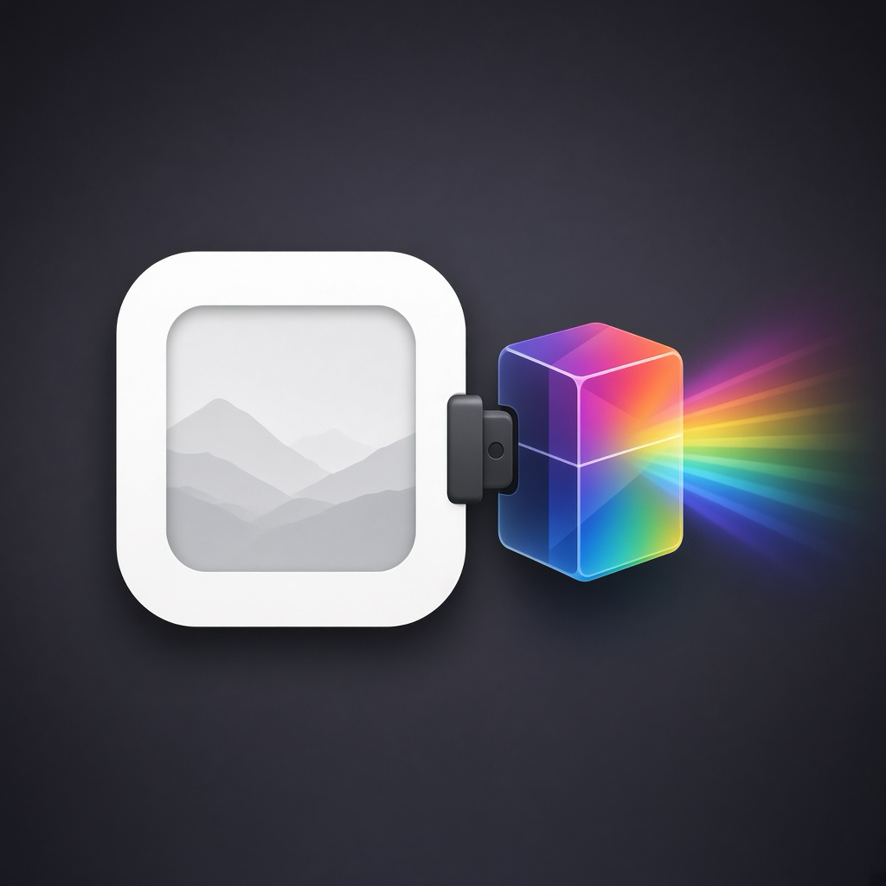

<p align="center">
  
</p>

# OfxHost

[](https://github.com/aaronmurniadi/ofxhost/releases/latest)
[](https://discord.gg/B69ZgZRzk)

<a href="https://www.buymeacoffee.com/aaronmurniadi"></a>

An OpenFX host for still images. Open a RAW file in the colour space you want to
work in, build a chain of OFX plugins, and export in a wide-gamut colour space.

Written in Go with a web interface, so the plugin engine and the export pipeline
run as native code and the interface stays easy to change.

Three effects ship with it, so the host is useful before any plugin is installed:
Transform, Auto Exposure, and Denoise (profiled).

## Tested OFX plugins

| Plugin              | What it does                                                                                                                                                                                                    | Link                                                                                                                         |
| ------------------- | --------------------------------------------------------------------------------------------------------------------------------------------------------------------------------------------------------------- | ---------------------------------------------------------------------------------------------------------------------------- |
| **spektrafilm-ofx** | Film simulation (film, print, scan, grain, halation, diffusion)                                                                                                                                                 | [chaert-s/spektrafilm-ofx](https://github.com/chaert-s/spektrafilm-ofx) / [spektrafilm.114c.de](https://spektrafilm.114c.de) |
| **ntsc-rs**         | Analog video / VHS-style effects                                                                                                                                                                                | [valadaptive/ntsc-rs](https://github.com/valadaptive/ntsc-rs)                                                                |
| **purzOS**          | A collection of 64 native OpenFX video plugins for DaVinci Resolve, Natron, and any other OFX host — retro/analog looks, pixelart, glitch, datamosh, CRT/VHS signal artifacts, colour grades and optical warps. | [purzbeats/purzos-ofx](https://github.com/purzbeats/purzos-ofx)                                                              |

Other OFX filter plugins should work. If you confirm one, a PR to this table is
welcome.

## Install

Download the build for your Mac from [Releases](https://github.com/aaronmurniadi/ofxhost/releases/latest).

| Mac | File |
| --- | --- |
| Apple Silicon (M1 and later) | `ofxhost-macOS-arm64.zip` |
| Intel | `ofxhost-macOS-x86_64.zip` |

Unzip it and drag **OfxHost** onto **Applications**. The app is ad-hoc signed, so on
first launch right-click it and choose **Open**, or clear the quarantine flag:

```sh
xattr -dr com.apple.quarantine /Applications/OfxHost.app
```

Each archive has a `.sha256` file beside it. Download both into one folder and check
the archive:

```sh
shasum -a 256 -c ofxhost-macOS-arm64.zip.sha256
```

The host reads plugins from the same directory every other OpenFX host uses, so a
plugin installed for Resolve or Natron is found without installing it twice:

| Platform | Default path |
| --- | --- |
| macOS | `/Library/OFX/Plugins` |
| Linux | `/usr/OFX/Plugins`, `/usr/local/OFX/Plugins` |
| Windows | `C:\Program Files\Common Files\OFX\Plugins` |

`OFX_PLUGIN_PATH` adds directories ahead of the default. An app started from Finder
does not see a shell variable, so start it from the terminal:

```sh
OFX_PLUGIN_PATH=/path/to/plugins /Applications/OfxHost.app/Contents/MacOS/OfxHost
```

Release builds for Linux and Windows are not published yet.

## Building

| Tool | Version | Notes |
| --- | --- | --- |
| Go | 1.26 or newer | |
| Wails CLI | v3.1.0 | `go install github.com/wailsapp/wails/v3/cmd/wails3@v3.1.0` |
| Node.js | 20 or newer | for the frontend |
| Task | 3.x | the build system Wails drives; `brew install go-task` |

The native libraries: libraw decodes the RAW, lcms2 converts colour, libpng, libtiff,
libjpeg, libwebp and libjxl write the export formats, and expat parses the plugin
descriptor XML.

```sh
# macOS
brew install libraw lcms2 libpng libtiff jpeg-turbo webp jpeg-xl expat

# Debian/Ubuntu
sudo apt install cmake libraw-dev liblcms2-dev libpng-dev libtiff-dev libjpeg-dev \
  libwebp-dev libjxl-dev libexpat1-dev
```

The OpenFX headers and the host support library are a submodule, and the library is
built by CMake. cgo cannot compile a translation unit outside its own package
directory, so this step must run before `go build`, and again after any change to
`host.cpp`:

```sh
git submodule update --init --recursive
cmake -S internal/adapter/ofxhost/native -B build/ofxhost-native -DCMAKE_BUILD_TYPE=Release
cmake --build build/ofxhost-native -j
```

Then build the program:

```sh
cd frontend && npm install && cd ..

wails3 generate bindings   # the frontend imports the generated bindings
task dev                   # build and run in development
task build                 # release binary
task darwin:package        # a macOS .app bundle with the bundled plugins inside
```

A bare `go build ./cmd/ofxhost` also works once `frontend/dist` has been built and
`libofxhost.a` exists; it produces a binary without the `.app` wrapper.

Check a change with the same commands the release pipeline runs:

```sh
go build ./...
go vet ./...
go test ./...
go run ./tools/layerguard
cd frontend && npx tsc --noEmit && npm test
```

## License

BSD-3-Clause. See `LICENSE`. The OpenFX SDK in `third_party/openfx` keeps its own
BSD-3-Clause licence. Every other dependency is permissive; the full list, with the
one LGPL obligation that needs action before a release, is in `THIRD_PARTY.md` once
it is written.
